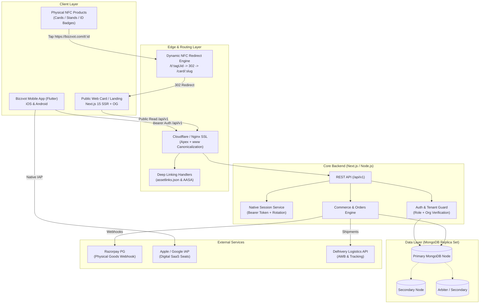

# Bizzvot Platform Master Implementation Plan
## Comprehensive Gap Remediation, Technical Architecture & Production Delivery Roadmap

**Document Version:** 1.0  
**Target Release:** Production Q4 2026  
**Audience:** Mobile Engineers, Backend Engineers, DevOps, Product Owners, Security & Compliance  
**Repositories Involved:**
- Mobile App: `creatyvot-source/Bizzvot-apps-` (Flutter)
- Backend API & Web: `creatyvot-source/cogcard` (Next.js 15, Node.js, MongoDB)
- Landing & Storefront: `creatyvot-source/nfc-landing-page`, `creatyvot-source/nfcwebsiteecom-`

---

## 1. Executive Summary & Master Gap Index

Across the 16 platform audits, the product specification (`docs/PRODUCT_PLAN.md`), and the active Flutter codebase, **32 structural gaps** were identified across 6 core domains.

| Domain | Total Gaps | Critical (P0) | High (P1) | Medium (P2) |
|---|---|---|---|---|
| **API Contract & Session Auth** | 7 | 3 | 3 | 1 |
| **Data Model & Tenant Isolation** | 6 | 2 | 3 | 1 |
| **Store Policy & Mobile Compliance** | 5 | 2 | 2 | 1 |
| **Commerce, NFC Hardware & Fulfilment**| 6 | 1 | 4 | 1 |
| **Privacy, Legal & Consumer Protection**| 5 | 1 | 3 | 1 |
| **Web, Deep Linking & Abuse Resilience**| 3 | 0 | 2 | 1 |
| **Total** | **32** | **9** | **17** | **6** |

### Top 9 P0 Critical Blockers Requiring Immediate Action
1. **[AUTH-P0-1] Native Bearer Auth Missing:** Backend issues only HTTP-only cookies; mobile app expects `{ accessToken, refreshToken }` JSON payload. Mobile sign-in currently fails with `NATIVE_SESSION_UNSUPPORTED`.
2. **[PRIV-P0-1] Public Review PII Leak:** `GET /public/card/:slug/reviews` returns `reviewerEmail` and internal `reply.repliedBy` ObjectId to unauthenticated visitors.
3. **[AUTH-P0-2] Role & Request Parameter Mismatches:** Backend expects `role: 'organization'` on registration, `newPassword` on reset; staff vs owner role checks allow `super_admin` into customer login.
4. **[STORE-P0-1] Digital Billing Policy Violation:** App Store Guideline 3.1.1 & Play Billing policy prohibit Razorpay for in-app digital SaaS seats/subscriptions. Digital subscriptions must use store IAP or compliant web-billing redirect.
5. **[STORE-P0-2] Missing Account Deletion:** App Store Guideline 5.1.1(v) requires in-app account deletion. Neither `DELETE /auth/account` nor the web deletion page exists on Coglink.
6. **[DATA-P0-1] Standalone MongoDB Topology:** Standalone Mongo without replica set cannot run multi-document ACID transactions needed for atomic order, payment, and entitlement updates.
7. **[SEC-P0-1] Owner Card Re-activation Tampering:** Card `status` in the owner update schema allows tenants to reactivate cards suspended by super-admin or billing quota.
8. **[NFC-P0-1] Static Chip Encoding Vulnerability:** Writing static URLs `/card/{slug}` to physical NFC hardware permanently bricks products when a customer updates their slug.
9. **[LEGAL-P0-1] Missing Legal Disclosures & App Config:** Missing `GET /app/config` leaves privacy policy, terms, seller identity, and grievance officer fields null in the mobile app.

---

## 2. End-to-End Target Architecture



---

## 3. Phased Implementation Roadmap

### Phase 1: Contract Stabilization, Auth & P0 Security Hotfixes (Weeks 1–2)
**Goal:** Unblock mobile sign-in, close active PII leaks, and fix broken API contracts.

#### 1.1 Backend Authentication Token Mode
- **Action:** Support `x-bizzvot-client: mobile` header on `/auth/login`, `/auth/staff-login`, `/auth/register`, and `/auth/refresh`.
- **Implementation:**
  - When header is present, return JSON payload:
    ```json
    {
      "success": true,
      "data": {
        "user": { "id": "...", "email": "...", "role": "organization", "name": "..." },
        "tokens": {
          "accessToken": "<jwt-ttl-1h>",
          "refreshToken": "<crypto-random-30d>"
        }
      }
    }
    ```
  - Create `RefreshToken` collection in MongoDB storing `{ userId, tokenHash, familyId, expiresAt, revokedAt }`.
  - Implement single-use refresh token rotation: if an already-used refresh token is presented, revoke the entire token family (compromise detection).
  - Update `/auth/logout` to revoke the specific refresh token rather than bumping global `tokenVersion`.

#### 1.2 Close Public Review PII Leak (F1)
- **Action:** Rewrite `app/api/v1/public/card/[slug]/reviews/route.ts` to use a strict allow-list DTO.
- **Payload Contract:**
  ```json
  {
    "id": "review_id",
    "reviewerName": "John Doe",
    "rating": 5,
    "comment": "Excellent service",
    "createdAt": "2026-10-11T12:00:00Z",
    "reply": {
      "text": "Thank you!",
      "createdAt": "2026-10-11T13:00:00Z"
    }
  }
  ```
  *(Explicitly omit `reviewerEmail`, `ipAddress`, `ipHash`, and `reply.repliedBy`).*

#### 1.3 Fix Request & Response Contract Mismatches
- **Role Alignment:** Ensure `POST /auth/register` requires `role: 'organization'` (already updated in Flutter mobile repository).
- **Password Reset:** Ensure `POST /auth/reset-password` accepts `newPassword` and clears lockout status upon success.
- **Track Click:** Standardize `POST /public/track-click` payload:
  ```json
  { "cardId": "string", "linkType": "whatsapp|phone|social|url", "linkUrl": "string" }
  ```
- **Staff List & Dashboard DTOs:** Populate staff member details cleanly (`userId.name`, `userId.email`) and dashboard overview metrics.

---

### Phase 2: Database Migration, Replica Set & Data Model Reconciliation (Weeks 3–4)
**Goal:** Enable transactional reliability, extend card & organization schemas, and fix tenant isolation.

#### 2.1 MongoDB Replica Set Migration
- **Action:** Convert production MongoDB from standalone to single-node or three-node replica set (`rs.initiate()`).
- **Rationale:** Enables MongoDB 4.0+ Multi-Document ACID Transactions (`mongoose.startSession()`), mandatory for commerce checkout and entitlement provisioning.

#### 2.2 Schema Extensions for Organizations & Cards
- **`organizations` Collection Updates:**
  - Add `directoryVisibility: { type: String, enum: ['public', 'private'], default: 'private' }`.
  - Add `planExpiry: { type: Date, default: null }`.
  - Add `seatLimit: { type: Number, default: 1 }`.
  - Add compound index: `{ ownerUserId: 1 }` (unique) and `{ slug: 1, status: 1 }`.
- **`cards` Collection Updates:**
  - Add `visibility: { type: String, enum: ['inherit', 'public', 'private'], default: 'inherit' }`.
  - Add `disabledByBilling: { type: Boolean, default: false }`.
  - Add `privateDetails: { bloodGroup: String, fatherName: String, motherName: String }` (never exposed in public DTOs).
  - Add `companyPhone: String`.
  - Extend `theme.templateId` enum to include: `'minimal'`, `'corporate'`, `'modern_dark'`, `'profile_hub'`, `'cover_card'`, `'review_card'`.
  - Add support for media arrays: `gallery` (max 5), `pdfs` (max 10), `videos` (max 5).
  - Add compound index: `{ organizationId: 1, staffUserId: 1 }` and `{ ownerType: 1, ownerId: 1 }`.
- **`reviews` Collection Updates:**
  - Add compound index: `{ cardId: 1, status: 1, createdAt: -1 }`.
  - Add rate-limiting hash: `{ cardId: 1, clientFingerprintHash: 1, createdAt: 1 }`.

#### 2.3 Tenant Security Hardening
- **Card Status Segregation:** Remove `status` from `organization/cards/:id` PATCH schema. Owners can only toggle `userDisabled: true/false`. Backend computes effective status:
  $$\text{effectiveStatus} = (\text{adminDisabled} \lor \text{disabledByBilling} \lor \text{userDisabled}) \text{ ? 'disabled' : 'active'}$$
- **Public Card Access Verification:** `GET /public/card/:slug` must verify:
  1. `card.status === 'active'`
  2. Organization is not suspended (`organization.status !== 'suspended'`)
  3. Plan is not expired (`planExpiry === null || planExpiry > new Date()`)

---

### Phase 3: Dynamic NFC Engine, Commerce & Physical Hardware Fulfilment (Weeks 5–7)
**Goal:** Deliver end-to-end ecommerce for the 4 physical NFC products and dynamic tag management.

#### 3.1 Dynamic NFC Tag Redirect Engine (`/t/:tagUid`)
- **Problem:** Static URLs on chips break if slugs change or cards are reassigned.
- **Solution:** Create `nfcTags` collection:
  ```typescript
  interface NFCTag {
    tagUid: string;          // Hex identifier or 8-char nanoid (e.g., 'BZ-94821')
    productType: 'stand' | 'card' | 'id_badge' | 'combo';
    targetType: 'card' | 'google_review' | 'custom_url';
    targetCardId?: ObjectId;
    targetUrl?: string;      // e.g., direct Google Review Place URL
    organizationId: ObjectId;
    status: 'unpaired' | 'active' | 'suspended';
    createdAt: Date;
    updatedAt: Date;
  }
  ```
- **Edge Redirect Route:** `GET /t/:tagUid`
  - High-speed lookup cached in Cloudflare/Redis (TTL 300s).
  - Responds with `302 Found` to current dynamic destination.
  - Logs NFC tap event asynchronously for analytics.

#### 3.2 Commerce & Orders API Implementation
Create dedicated backend endpoints:
- `GET /catalog/products`: List 4 NFC physical products + SaaS plans.
- `POST /cart/quote`: Authoritative server-side price calculation including GST (CGST/SGST 18%) and shipping.
- `POST /orders`: Creates draft order with idempotency key.
- `POST /orders/:id/payment`: Initializes Razorpay payment order.
- `POST /webhooks/razorpay`: Authoritative webhook handler:
  - Verify HMAC SHA-256 signature (`X-Razorpay-Signature`).
  - Idempotent transaction execution: Mark order `paid`, create tax invoice, update inventory.
  - Trigger email confirmation.

#### 3.3 Logistics & Fulfilment Integration (Delhivery)
- **Integration Points:**
  1. Checkout: Validate pincode serviceability via Delhivery Pincode API.
  2. Packing: Admin portal generates shipping label & AWB number via Delhivery Shipment Creation API.
  3. Tracking: Store AWB on order; expose real-time tracking in customer order detail screen (`/orders/:id`).

---

### Phase 4: Store Submission, App Store Policy (IAP vs Web) & Account Deletion (Weeks 8–9)
**Goal:** Guarantee 100% compliance with Apple App Store Review Guidelines and Google Play Developer Policies.

#### 4.1 Digital SaaS Billing Policy Resolution (Guideline 3.1.1)
- **Policy Conflict:** Digital card seats and organization plan renewals cannot use Razorpay inside the iOS app.
- **Compliance Architecture:**
  - **Physical Products (NFC Stands, Cards, ID Badges):** Compliant with external payment gateways (Razorpay). Allowed on both iOS and Android.
  - **Digital Plans & Seat Purchases:**
    - *Phase 1 Strategy (Zero Rejection Risk):* Treat mobile app as a business companion / reader app. In `SeatPurchaseScreen` and `BillingScreen`, display current plan quota and seat utilization. When user taps "Add Seats" or "Upgrade Plan", display:
      > "Plan upgrades and seat management are configured via the Bizzvot Web Console."
      > [Open Web Billing in Browser (https://www.bizzvot.com/dashboard/billing)]
    - *Phase 2 Strategy (Post-Launch Enhancement):* Implement Apple In-App Purchase and Google Play Billing using RevenueCat for auto-renewing seat subscriptions.

#### 4.2 Mandatory Store Account Deletion (Guideline 5.1.1(v))
- **Backend API:** Implement `DELETE /auth/account`:
  - Requires re-authentication with current password.
  - Verifies caller is organization owner.
  - Anonymizes reviews and audit logs; deletes organization cards, staff profiles, and uploaded media.
  - Revokes all active refresh tokens.
- **Web Deletion Page:** Deploy public web URL `https://www.bizzvot.com/account/delete` satisfying Google Play Store's requirement for external account deletion request portal.

#### 4.3 Remote App Config (`GET /app/config`)
Deploy anonymous endpoint returning operational parameters:
```json
{
  "version": { "minRequired": "0.1.0", "latest": "0.1.0" },
  "maintenance": { "active": false, "message": "" },
  "legal": {
    "privacyPolicyUrl": "https://www.bizzvot.com/privacy",
    "termsUrl": "https://www.bizzvot.com/terms",
    "refundPolicyUrl": "https://www.bizzvot.com/refunds"
  },
  "seller": {
    "legalName": "Bizzvot Technologies Private Limited",
    "gstin": "32XXXXXXXXXX1Z5",
    "supportEmail": "support@bizzvot.com"
  },
  "grievanceOfficer": {
    "name": "Grievance Officer",
    "email": "grievance@bizzvot.com"
  }
}
```

#### 4.4 iOS & Android Release Configuration
- **Android Signing:** Replace debug keystore with production upload keystore in `android/app/build.gradle`.
- **iOS Permissions:** Add `NSPhotoLibraryAddUsageDescription` to `ios/Runner/Info.plist`:
  ```xml
  <key>NSPhotoLibraryAddUsageDescription</key>
  <string>Bizzvot needs permission to save digital business card QR codes to your photo library.</string>
  ```
- **Deep Link Assets:**
  - Host `https://www.bizzvot.com/.well-known/assetlinks.json` with SHA-256 fingerprint.
  - Host `https://www.bizzvot.com/.well-known/apple-app-site-association` with App ID.
  - Add Associated Domains entitlement `applinks:www.bizzvot.com` and `applinks:bizzvot.com` to Xcode project.

---

### Phase 5: Public Web Experience, SEO, Deep Linking & Abuse Hardening (Weeks 10–11)
**Goal:** Deliver high-speed public web card rendering, dynamic social previews, and bot-proof review submission.

#### 5.1 Public Card Web SSR & Open Graph Metadata
- Implement Next.js App Router `generateMetadata` for `/card/[slug]`:
  - Dynamically inject title: `"${card.title} - ${card.designation} | Bizzvot"`.
  - Dynamic `og:image` pointing to card profile photo or generated card preview card.
  - Return proper HTTP 404 status when a card does not exist or is suspended.

#### 5.2 Multi-Layered Review Abuse Resilience
Replace brittle single-IP blocking with a composite risk score:
1. **Cooldown Rate Limiting:** Max 2 reviews per 10-minute window per IP subnet (allowing multiple legitimate customers on store Wi-Fi over time).
2. **Invisible Honeypot Field:** Hidden field in review form; submissions with content are silently dropped.
3. **Sentiment & Profanity Filter:** Automated regex and profanity dictionary check before reviews enter `pending` state.
4. **Standard 429 Responses:** Always include `Retry-After: <seconds>` on rate limit triggers.

---

### Phase 6: End-to-End QA, Security Penetration & Staged Rollout (Weeks 12–13)
**Goal:** Zero-defect release across devices, OWASP MASVS verification, and staged app store release.

#### 6.1 Test Automation Matrix
- **Unit & Contract Tests:** Verify 100% of API endpoints against typed DTO models.
- **Tenant Isolation Tests:** Automated tests asserting owner A cannot read/update owner B resources.
- **Device Compatibility Matrix:**
  - Android: API 24 (Android 7.0) through API 36 (Android 16), testing varied screen sizes and text scaling (up to 200%).
  - iOS: iOS 15.0 through iOS 18+, iPhone and iPad layouts.

#### 6.2 Staged Rollout Plan
- **Day 1–3:** Internal QA & TestFlight / Google Play Internal Testing track.
- **Day 4–7:** Closed Beta (50 pilot organizations).
- **Day 8:** Google Play staged rollout (10% -> 25% -> 50% -> 100%).
- **Day 10:** Apple App Store release with phased release enabled.

---

## 4. Product & Hardware Fulfilment Matrix

| Product | Retail Price | Hardware Tag | Target Destination | Fulfilment Workflow |
|---|---|---|---|---|
| **Google Review Stand** | ₹499 | NTAG213 Acrylic Stand | `https://bizzvot.com/t/:tagUid` -> Google Review URL | 1. Customer provides Google Place ID<br/>2. Encode tag & print QR stand<br/>3. Ship via Delhivery |
| **Google Review Card** | ₹350 | NTAG213 PVC Card | `https://bizzvot.com/t/:tagUid` -> Google Review URL | 1. Generate redirect link<br/>2. UV print card + encode chip<br/>3. Ship via Delhivery |
| **Staff ID Card (Card Only)** | ₹350 | NTAG213 PVC Card | `https://bizzvot.com/t/:tagUid` -> Staff Card Slug | 1. Staff photo + name personalization<br/>2. Dual-side thermal print & encode<br/>3. Ship via Delhivery |
| **Business Digital + Physical NFC Card** | ₹999 | NTAG216 Premium Card | `https://bizzvot.com/t/:tagUid` -> Org/Staff Card Slug | 1. Complete business digital profile<br/>2. Custom metallic/matte card finish<br/>3. Pair with digital subscription<br/>4. Ship via Delhivery |

---

## 5. Traceability & Gap Closure Matrix

| Gap ID | Description | Remediation Phase | Responsible Team | Verification Artifact |
|---|---|---|---|---|
| **AUTH-1** | Native Bearer tokens missing | Phase 1 (Sprint 1) | Backend | Integration test `auth_bearer_spec.ts` |
| **AUTH-2** | Refresh & logout request shapes | Phase 1 (Sprint 1) | Backend + Mobile | Unit test `auth_flow_repository_test.dart` |
| **AUTH-3** | Staff assigned card & permissions | Phase 1 (Sprint 1) | Backend | Contract test `staff_me_spec.ts` |
| **AUTH-4** | Stable machine error codes | Phase 1 (Sprint 1) | Backend + Mobile | Error mapper test `app_exception_test.dart` |
| **PRIV-1** | Reviewer email leak in public API | Phase 1 (Sprint 1) | Backend | Security test `public_review_pii_spec.ts` |
| **DATA-1** | MongoDB standalone -> Replica Set | Phase 2 (Sprint 2) | DevOps / DBA | Replica set status `rs.status()` |
| **DATA-2** | Missing schema fields (vis/media) | Phase 2 (Sprint 2) | Backend | Schema migration script `migrate_v1_v2.ts` |
| **DATA-3** | Missing indexes on orgs & cards | Phase 2 (Sprint 2) | DBA | Index verification query `db.getIndexes()` |
| **NFC-1** | Dynamic tag redirect engine | Phase 3 (Sprint 3) | Backend + Edge | Benchmark test `redirect_latency_test.ts` |
| **COM-1** | Commerce & catalogue API | Phase 3 (Sprint 3) | Backend + Mobile | E2E order test `checkout_flow_spec.ts` |
| **COM-2** | Razorpay webhook idempotency | Phase 3 (Sprint 3) | Backend | Webhook replay test `webhook_test.ts` |
| **COM-3** | Delhivery logistics integration | Phase 3 (Sprint 3) | Backend | Shipment test `delhivery_api_spec.ts` |
| **STORE-1**| In-App Purchase compliance policy | Phase 4 (Sprint 4) | Mobile + Product | App Store Review Guideline 3.1.1 audit |
| **STORE-2**| In-app account deletion endpoint | Phase 4 (Sprint 4) | Backend + Mobile | App Store Review Guideline 5.1.1 audit |
| **STORE-3**| Remote app config (`/app/config`)| Phase 4 (Sprint 4) | Backend + Mobile | Endpoint test `app_config_spec.ts` |
| **STORE-4**| iOS Photo Library permission | Phase 4 (Sprint 4) | Mobile | `Info.plist` & manual QR save test |
| **STORE-5**| Deep links verification files | Phase 4 (Sprint 4) | DevOps / Web | Validation via Apple / Google deep link tools |
| **LEGAL-1**| DPDP & Consumer Protection disclosures | Phase 4 (Sprint 4) | Legal + Backend | In-app legal disclosure screen audit |
| **WEB-1**  | Public web card SSR & OpenGraph | Phase 5 (Sprint 5) | Frontend Web | Social preview test via WhatsApp/Twitter cards|
| **ABUSE-1**| Smart review rate limiting & spam | Phase 5 (Sprint 5) | Backend | Stress test `review_flood_test.ts` |

---

## 6. Definition of Done (DoD)

The Bizzvot customer mobile app and platform ecosystem are certified **Production Ready** when:
1. **Zero High/Critical Vulnerabilities:** Automated DAST/SAST scan passes with zero OWASP Mobile Top 10 or API Security Top 10 violations.
2. **Native Auth Certified:** 100% of mobile login, token refresh, and logout tests succeed on iOS and Android devices without session dropped errors.
3. **Multi-Document Transactions Active:** MongoDB transactions tested for concurrent checkout, card creation, and seat allocation without race conditions.
4. **Hardware NFC Verified:** All 4 physical products successfully route through `/t/:tagUid` and redirect accurately across iOS and Android NFC readers.
5. **App Store Readiness Approved:**
   - Apple App Store Guideline 3.1.1 compliance verified (digital goods web-routed / reader model; physical goods via Razorpay).
   - Guideline 5.1.1(v) account deletion end-to-end verified.
   - Associated Domains and Asset Links validate with 200 OK and valid JSON.
6. **Production Telemetry Live:** Sentry / Datadog crash reporting and performance monitoring configured with PII redaction rules strictly enforced.

---

## 7. Modern Discovery UI Architecture & Content Adaptation (Airbnb-Style Layout Conversion)

### 7.1 Visual Layout Blueprint & Component Breakdown

The mobile discovery experience across the **Bizzvot Shop & Hardware Showcase** and the **People & Digital Cards Directory** has been adapted from the modern, image-forward Airbnb discovery feed pattern shown in the reference design.

```text
+-------------------------------------------------------------+
|  [Status Bar: Time, Wi-Fi, Battery]                         |
|                                                             |
|  +-------------------------------------------------------+  |
|  | (Q) Find NFC Cards & Stands                           |  |  <- 1. FloatingSearchCapsule
|  |     Review Stands * Smart Cards * Badges        [(|)] |  |     (BorderRadius: 32dp, Soft Shadow)
|  +-------------------------------------------------------+  |
|                                                             |
|   (ALL)      (*)          (==)        ([ID])       (B2B)    |  <- 2. CategoryIconTabBar
|  All NFC  Stands(★)    Smart Cards   ID Badges    Bundles   |     (Horizontal Scroll, Active Underline)
|  =======                                                    |
|-------------------------------------------------------------|
|                                                             |
|  +-------------------------------------------------------+  |  <- 3. DiscoveryMediaCard
|  | [Bestseller]                           [ (♥) Fav ]    |  |     - AspectRatio: 4 / 3
|  |                                                       |  |     - PageView Carousel
|  |                                                       |  |     - Page Indicator Dots
|  |                                                       |  |     - Overlaid Avatar Badge
|  |                                                       |  |     - Rounded Media (16dp)
|  |  (Avatar)                                   (o o o)   |  |
|  +-------------------------------------------------------+  |
|   Google Review Stand — Countertop Acrylic       ★ 4.98     |  <- Row 1: Title & Star Rating
|   Bizzvot Official · Instant Google Review Tap              |  <- Row 2: Tech & Features
|   Ships in 24 hrs · Dynamic NTAG213 Chip · Free Delivery    |  <- Row 3: Fulfilment
|   ₹499 total                                                |  <- Row 4: Bold Price Block
|                                                             |
|  +-------------------------------------------------------+  |
|  | [NFC Tap]                              [ (♡) Fav ]    |  |
|  |                                                       |  |
|  |  (Avatar)                                   (o o o)   |  |
|  +-------------------------------------------------------+  |
|   Staff ID Smart Card — NFC & Dynamic QR        ★ 4.95     |
|   Dual-side Thermal Print · Instant vCard Save              |
|   Custom logo & staff photo · Ships in 48 hrs               |
|   ₹350 / card                                               |
|                                                             |
|-------------------------------------------------------------|
|   (Q)          (♥)           ([D])         (★)        (O)   |  <- 4. BottomNavBar
|  Explore    Wishlist       My Cards      Reviews    Profile |     (5 Sleek Destinations)
+-------------------------------------------------------------+
```

---

### 7.2 Domain Content Adaptation Matrix

The table below outlines how Airbnb's hospitality layout attributes are converted into Bizzvot's business hardware, services, and digital card ecosystem:

| Airbnb Reference Attribute | Bizzvot Hardware & NFC Shop | Bizzvot People & Digital Cards Directory |
|---|---|---|
| **Search Pill Headline** | `"Find NFC Cards & Stands"` | `"Search Professionals & Staff"` |
| **Search Pill Subtitle** | `"Review Stands · Smart Cards · Badges"` | `"Kochi, Kerala · Healthcare · Tech"` |
| **Filter Button** | Filter by Product Type, Material, Chip (NTAG213/216) | Filter by Department, Designation, Verified Status |
| **Horizontal Icon Tabs** | All NFC, Review Stands, Smart Cards, Staff Badges, Bundles | All Staff, Executive, Consulting, Healthcare, Retail |
| **Active Tab Indicator** | Bold text + 2.2dp solid bottom underline indicator | Bold text + 2.2dp solid bottom underline indicator |
| **Media Container** | 4:3 high-res photo carousel (Front, Back, Countertop, 3D) | 4:3 digital card live preview carousel / cover |
| **Carousel Dots** | Active dot (white 7dp), inactive dots (white 55% opacity) | Active dot (white 7dp), inactive dots (white 55% opacity)|
| **Top-Right Heart** | Add product to Wishlist / Saved items | Bookmark contact / Save to personal wallet |
| **Bottom-Left Avatar** | **Bizzvot Verified Hardware / Brand Logo Badge** | **Staff Member Photo Avatar Badge** (34dp + 2.2dp white border) |
| **Title (Left)** | Product name (e.g., `"Google Review Stand (Acrylic)"`) | Staff name & title (e.g., `"Dr. Sarah Khan — Consultant"`) |
| **Rating (Right)** | Verified buyer reviews (e.g., `"★ 4.98 (218)"`) | Customer review score (e.g., `"★ 4.90 (48)"`) |
| **Line 2 (Subtitle)** | Hardware specs: `"Bizzvot Official · Instant Tap"` | Organization: `"Apex Healthcare · 8 yrs verified"` |
| **Line 3 (Fulfilment)** | Shipping SLA: `"Ships in 24 hrs · Dynamic NTAG213"` | Actions: `"Direct Call, WhatsApp & vCard Ready"` |
| **Line 4 (Price)** | Clear pricing: `"₹499 total"` or `"₹350 / card"` | Action tag: `"vCard Ready · Tap to Connect"` |

---

### 7.3 Flutter Component Architecture & Code Implementation

To deliver this experience natively in Flutter, the following components have been constructed in the codebase:

1. **[`FloatingSearchCapsule`](file:///Users/muhammedkc/Bizvot%20app/lib/features/catalog/presentation/widgets/floating_search_capsule.dart):**
   - Elevated capsule pill with 32dp border radius, soft drop shadow (`color: 0x14000000, blurRadius: 16, offset: (0, 4)`).
   - Search icon, 2-line title/subtitle layout, and circular outlined filter button.
2. **[`CategoryIconTabBar`](file:///Users/muhammedkc/Bizvot%20app/lib/features/catalog/presentation/widgets/category_icon_tab_bar.dart):**
   - Horizontal scrolling list of category items with outline icons, typography, and active bottom underline indicators.
3. **[`DiscoveryMediaCard`](file:///Users/muhammedkc/Bizvot%20app/lib/features/catalog/presentation/widgets/discovery_media_card.dart):**
   - Immersive card featuring `PageView.builder` carousel with page indicator dots, top-right wishlist heart toggle, bottom-left overlaid circular avatar badge, star rating row, subtitle, delivery SLA, and bold price hierarchy.
4. **[`ShopHomeScreen`](file:///Users/muhammedkc/Bizvot%20app/lib/features/catalog/presentation/shop_home_screen.dart):**
   - Updated to assemble the floating search capsule, icon category tab bar, and responsive grid of discovery media cards.

---

### 7.4 Design Tokens & Micro-Interactions

- **Elevation & Depth:**
  - Search capsule: `BoxShadow(color: Color(0x14000000), blurRadius: 16, offset: Offset(0, 4))`.
  - Avatar badge: `BoxShadow(color: Color(0x33000000), blurRadius: 6, offset: Offset(0, 2))`.
  - Media canvas: Borderless card with subtle gradient overlay (`LinearGradient([black.withOpacity(0.4), transparent])`) for badge legibility.
- **Corner Radii:**
  - Search capsule: `BorderRadius.circular(32)`.
  - Media container: `BorderRadius.circular(16)`.
  - Status badges: `BorderRadius.circular(12)`.
  - Avatar badge: `CircleAvatar(radius: 17)`.
- **Typography Scale:**
  - Headline: 15sp, `FontWeight.w700`, line height 1.25.
  - Subtitle: 13sp, `FontWeight.w400`, color `Color(0xFF71717A)`.
  - Delivery metadata: 12sp, `FontWeight.w400`, color `Color(0xFFA1A1AA)`.
  - Price: 15sp, `FontWeight.w800`, color `Colors.black` / `Colors.white`.
- **Micro-Interactions:**
  - Carousel scroll: Horizontal swipe with smooth 250ms animated container width transition on dot indicators.
  - Wishlist heart: Spring bounce animation with red/white color toggle.
  - Category tabs: 2.2dp solid bottom line transition on tap.

