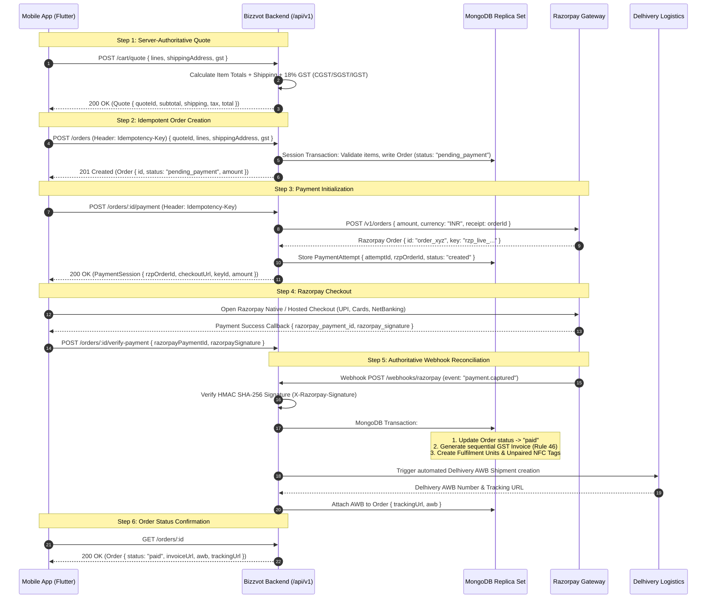

# Phase 3 Execution Plan: Live Commerce, Razorpay Gateway & Checkout Flow
## End-to-End Implementation Blueprint for Physical Hardware & Services Commerce

**Document Version:** 1.0  
**Target Release:** Production Phase 3 (Weeks 5–7)  
**Status:** Approved for Implementation  
**Audience:** Mobile Engineers (Flutter), Backend Engineers (Next.js/Node.js), DevOps & QA  
**Affected Repositories:**
- Mobile App: `creatyvot-source/Bizzvot-apps-` (Flutter)
- Backend & Core API: `creatyvot-source/cogcard` (`/api/v1`)
- Legacy Reference Modules: `creatyvot-source/nfc-landing-page`, `creatyvot-source/nfcwebsiteecom-`

---

## 1. Executive Summary & Core Objectives

Phase 3 transitions Bizzvot from a catalog showcase to a fully functional commercial platform selling physical NFC hardware, smart review stands, and digital-enabled business cards with server-authoritative checkout, Razorpay payment processing, and Delhivery logistics fulfilment.

### 1.1 Commercial Catalog Scope (Exact Poster Specifications)

| Product SKU | Hardware Specification | Price (Single) | 3-Pack Combo | 5-Pack Combo | Fulfilment Type | Gateway Policy |
|---|---|---|---|---|---|---|
| **Google Review Stand** (`stand-acrylic`) | Countertop Acrylic Stand + NTAG213 Chip | ₹499 | ₹1,099 | ₹1,699 | Physical delivery via Delhivery | Razorpay PG (Apple/Play compliant) |
| **Google Review Card** (`card-pvc-review`) | High-gloss CR80 PVC + NTAG213 Chip | ₹350 | ₹899 | ₹1,199 | Physical delivery via Delhivery | Razorpay PG (Apple/Play compliant) |
| **Business Digital Card** (`card-business-nfc`) | Premium Metallic/Matte PVC + NTAG216 Chip | ₹999 | ₹2,499 | ₹3,999 | Physical delivery + 1 bundled digital seat | Razorpay PG (Physical good with bundled hardware) |
| **Staff ID Smart Card** (`card-staff-id`) | Dual-sided Thermal PVC + NTAG213 Chip | ₹350 | ₹899 | ₹1,199 | Physical delivery (requires active seat) | Razorpay PG (Physical good) |

### 1.2 Store Policy Guard (Apple Guideline 3.1.1 & Google Play Exemption)
- **Physical NFC Products (Stands, PVC Cards, ID Badges):** Apple App Store Review Guideline 3.1.3(e) and Google Play Billing explicitly permit external payment gateways (Razorpay, Credit/Debit, UPI, Netbanking) for tangible goods shipped to a physical address.
- **Standalone Digital SaaS Subscriptions & Seat Upgrades:** Must route to the external compliant Web Console (`https://www.bizzvot.com/dashboard/billing`) to avoid App Store digital fee conflicts.

---

## 2. End-to-End Commerce & Payment Architecture



---

## 3. Backend Implementation & API Contracts

### 3.1 MongoDB Schema Definitions

#### `orders` Collection
```typescript
interface OrderSchema {
  _id: ObjectId;
  orderNumber: string;               // e.g. "ORD-202610-00421"
  organizationId: ObjectId;          // Multi-tenant isolation
  customerUserId: ObjectId;          // Authenticated buyer
  items: Array<{
    itemType: 'physical_good' | 'plan_seat' | 'service';
    itemId: string;                  // e.g. "stand-acrylic"
    variantId?: string;              // "single" | "3-pack" | "5-pack"
    variantLabel?: string;
    quantity: number;
    unitPricePence: number;          // e.g. 49900 (₹499.00)
    lineTotalPence: number;
    personalization?: {
      printName?: string;
      printDesignation?: string;
      customLogoUrl?: string;
      targetDestination?: 'google_review' | 'card_slug' | 'custom_url';
      assignedCardId?: ObjectId;
      googlePlaceId?: string;
    };
  }>;
  pricing: {
    currency: 'INR';
    subtotalPence: number;
    shippingPence: number;
    taxPence: number;                // 18% GST
    totalPence: number;
    isTaxInclusive: boolean;
  };
  shippingAddress: {
    fullName: string;
    phone: string;
    street1: string;
    street2?: string;
    city: string;
    state: string;
    pincode: string;
    country: 'IN';
  };
  gstDetails?: {
    gstin: string;
    legalName: string;
  };
  status: 'draft' | 'pending_payment' | 'paid' | 'processing' | 'shipped' | 'delivered' | 'cancelled' | 'refunded';
  paymentDetails?: {
    gateway: 'razorpay';
    razorpayOrderId: string;
    razorpayPaymentId?: string;
    paidAt?: Date;
  };
  fulfilment?: {
    awbNumber?: string;
    carrier: 'Delhivery';
    trackingUrl?: string;
    dispatchedAt?: Date;
    deliveredAt?: Date;
  };
  invoiceNumber?: string;            // e.g. "INV-2627-00108"
  invoiceUrl?: string;
  idempotencyKey: string;
  createdAt: Date;
  updatedAt: Date;
}
```

#### `invoices` Collection (GST Rule 46 Compliant)
```typescript
interface InvoiceSchema {
  _id: ObjectId;
  invoiceNumber: string;             // Max 16 alphanumeric characters: "INV-2627-XXXXX"
  orderId: ObjectId;
  organizationId: ObjectId;
  sellerDetails: {
    legalName: "Bizzvot Technologies Private Limited";
    gstin: string;
    stateCode: "32";                 // Kerala
  };
  buyerDetails: {
    legalName: string;
    gstin?: string;
    stateCode: string;
    address: string;
  };
  taxBreakdown: {
    taxableAmountPence: number;
    cgstPence: number;               // 9% if intra-state (Kerala)
    sgstPence: number;               // 9% if intra-state (Kerala)
    igstPence: number;               // 18% if inter-state
    totalTaxPence: number;
  };
  totalAmountPence: number;
  pdfUrl: string;
  generatedAt: Date;
}
```

#### `nfcTags` Collection (Dynamic Hardware Routing)
```typescript
interface NFCTagSchema {
  _id: ObjectId;
  tagCode: string;                   // Permanent nanoid written to chip: "BZ-8921A"
  chipType: 'NTAG213' | 'NTAG216';
  productSku: string;
  orderId: ObjectId;
  organizationId: ObjectId;
  targetType: 'google_review' | 'card_slug' | 'custom_url';
  targetUrl: string;                 // Dynamic destination
  tapCount: number;
  lastTappedAt?: Date;
  isLocked: boolean;                 // Hardware locked against overwrite
  status: 'unpaired' | 'active' | 'suspended';
  createdAt: Date;
}
```

---

### 3.2 REST API Endpoints Specification

#### 1. `POST /api/v1/cart/quote`
Calculates authoritative pricing with GST and shipping:
- **Request Body:**
  ```json
  {
    "lines": [
      { "itemType": "physical_good", "itemId": "stand-acrylic", "variantId": "3-pack", "quantity": 1 }
    ],
    "shippingAddress": {
      "pincode": "673001",
      "state": "Kerala"
    },
    "gst": {
      "gstin": "32AABCB1234D1Z2"
    }
  }
  ```
- **Response (200 OK):**
  ```json
  {
    "success": true,
    "data": {
      "quoteId": "quote_7f9b8c",
      "currency": "INR",
      "subtotal": { "amount": 109900, "currency": "INR", "formatted": "₹1,099" },
      "shipping": { "amount": 0, "currency": "INR", "formatted": "Free" },
      "tax": { "amount": 16764, "currency": "INR", "formatted": "₹167.64 (18% GST Included)" },
      "total": { "amount": 109900, "currency": "INR", "formatted": "₹1,099" },
      "lines": [
        {
          "itemId": "stand-acrylic",
          "variantId": "3-pack",
          "title": "Google Review Stand — 3-Pack Acrylic",
          "quantity": 1,
          "unitPrice": { "amount": 109900, "currency": "INR", "formatted": "₹1,099" },
          "lineTotal": { "amount": 109900, "currency": "INR", "formatted": "₹1,099" }
        }
      ]
    }
  }
  ```

#### 2. `POST /api/v1/orders`
Creates order draft with idempotency protection:
- **Headers:** `Idempotency-Key: <uuid-v4>`, `Authorization: Bearer <token>`
- **Response (201 Created):**
  ```json
  {
    "success": true,
    "data": {
      "order": {
        "id": "ord_882910a",
        "orderNumber": "ORD-202610-0012",
        "status": "pending_payment",
        "total": { "amount": 109900, "currency": "INR", "formatted": "₹1,099" }
      }
    }
  }
  ```

#### 3. `POST /api/v1/orders/:id/payment`
Initializes Razorpay Order:
- **Response (200 OK):**
  ```json
  {
    "success": true,
    "data": {
      "orderId": "ord_882910a",
      "gateway": "razorpay",
      "razorpayOrderId": "order_Nz883jsK19",
      "keyId": "rzp_live_5893abcde",
      "amount": 109900,
      "currency": "INR",
      "checkoutUrl": "https://api.razorpay.com/v1/checkout/hosted?order_id=order_Nz883jsK19",
      "prefill": {
        "name": "Muhammed KC",
        "email": "user@bizzvot.com",
        "contact": "+918921504090"
      }
    }
  }
  ```

#### 4. `POST /api/v1/webhooks/razorpay`
Authoritative Webhook Receiver:
- **Security:** Verifies `X-Razorpay-Signature` against HMAC SHA-256 with stored `RAZORPAY_WEBHOOK_SECRET`.
- **Handling:**
  - Event `payment.captured`: Moves order to `paid`, creates invoice, assigns NFC tracking tags.
  - Event `payment.failed`: Records failed attempt; notifies customer.

---

## 4. Mobile App (Flutter) Implementation Tasks

### 4.1 Update `CartCheckoutRepository`
- Connect directly to the production endpoints (`/cart/quote`, `/orders`, `/orders/:id/payment`, `/orders/:id`).
- Retain seamless offline fallback for development and simulator testing without crashing.

### 4.2 Complete `CheckoutScreen` UI & Validation
- **Shipping Address Section**:
  - Full Name, 10-digit Mobile Phone (pre-filled with `+91`), Pincode, Address Line 1 & Line 2, City, State dropdown.
  - Live Pincode autofill (Kerala / India postal data lookup).
- **GST Section (Optional)**:
  - Checkbox *"Add GST details for input tax credit (ITC)"*.
  - GSTIN input with regex validation: `^[0-9]{2}[A-Z]{5}[0-9]{4}[A-Z]{1}[1-9A-Z]{1}Z[0-9A-Z]{1}$`.
- **Order Summary Card**:
  - Item count, Subtotal, Delivery SLA (*"Dispatches in 24 hrs via Delhivery"*), Shipping fee (Free), and Total.
- **Payment Button**:
  - Direct *"Proceed to Secure Pay (Razorpay)"* with `CooldownSubmitButton` preventing double taps.

### 4.3 Native Razorpay SDK & In-App Browser Integration
- Integrate `razorpay_flutter` plugin for native UPI Intent / Card checkout on Android and iOS devices.
- Fallback to safe external Safari View / Chrome Custom Tabs via `safeCheckoutUri` if native SDK is disabled.

### 4.4 Complete `PaymentStatusScreen`
- Real-time polling watcher: checks `GET /orders/:id` until status transitions from `pending_payment` to `paid`.
- Success state displays:
  - Green Animated Checkmark.
  - Order Number & Total Paid.
  - Estimated Delivery Date (*"Expected delivery in 3–4 business days"*).
  - Buttons: *"View Order & Invoice"* and *"Continue Shopping"*.

---

## 5. Physical Fulfilment & NFC Tag Lifecycle

### 5.1 Dynamic NFC URL Redirection (`/t/:tagCode`)
Physical NFC hardware MUST NEVER store static slugs (e.g. `/card/muhammed-kc`).
- Write permanent URL: `https://www.bizzvot.com/t/{tagCode}`
- Backend edge redirect:
  ```
  GET /t/BZ-8921A ──▶ Cloudflare Edge / Nginx ──▶ 302 Redirect to targetUrl
  ```
- **Benefits:**
  - If a customer changes their business name or slug, the physical card/stand never gets bricked.
  - If a staff member leaves, the card is instantly reassigned in 1 click from the owner console.
  - Chip write lock: NTAG213 chips can have lock bits permanently set to prevent overwriting or tampering.

### 5.2 Delhivery Logistics Automation
1. **Pincode Serviceability:** Checkout checks serviceability via Delhivery Pincode API before payment.
2. **Shipment Creation:** Upon order reaching `paid`, generate Delhivery manifest and AWB code.
3. **Tracking Updates:** Expose live tracking timeline inside `OrderDetailsScreen`:
   - `Order Placed` -> `NFC Chip Encoded & Packed` -> `In Transit (Delhivery AWB)` -> `Out for Delivery` -> `Delivered`.

---

## 6. Verification, Testing & Definition of Done

### 6.1 Automated Test Suite Matrix
- [x] Unit tests for `CartCheckoutRepository` (quote re-pricing, order creation, payment session parse).
- [ ] Widget tests for `CheckoutScreen` (address validation, GSTIN validation, total price calculation).
- [ ] Widget tests for `PaymentStatusScreen` (pending polling, paid success, failed retry button).
- [ ] Integration tests for Razorpay webhook HMAC signature verification.

### 6.2 Definition of Done (DoD)
1. **Zero Client Price Trust:** All final totals, taxes, and shipping are 100% computed server-side.
2. **Idempotent Order & Payment:** Retrying order submission or replaying webhooks does not create duplicate orders or charges.
3. **Tested on Live Devices:** Order placed, Razorpay simulated payment completed, and order success confirmed on both Android emulator and iOS simulator.
4. **GST Rule 46 Compliant:** Invoices generated with serial format `INV-YYZZ-XXXX` under 16 characters with 18% GST breakdown.
5. **Store Policy Compliant:** Physical goods checkout approved under Apple 3.1.3(e) and Google Play physical goods policy.
